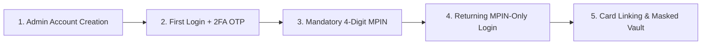

# 🏛️ MBI — Modern Bank Of India

**Next-Generation Core Banking & Digital Account Management Platform**

A full-stack digital banking ecosystem featuring role-based governance, real-time double-entry ledgers, 3D interactive virtual debit cards, and multi-layered customer authentication—built with a **React + Vite** frontend, a **Java (Spring Boot 3.4)** backend, and a **SQL** relational database.

---

## 📋 Table of Contents

- [Platform Overview](#-platform-overview)
- [Quick Start (1-Click Launch)](#-quick-start-1-click-launch)
- [Manual Terminal Setup](#-manual-terminal-setup)
- [Bank Administrator (Master Authority)](#-bank-administrator-master-authority)
- [Customer Lifecycle & Security Architecture](#-customer-lifecycle--security-architecture)

---

## 🌟 Platform Overview

Modern Bank Of India (MBI) simulates a retail banking environment with a decoupled **React + Vite** client and a **Java Spring Boot 3.4** REST API. Static dummy data is removed in favor of an end-to-end banking workflow—from branch-level onboarding to MPIN-protected customer access.

---

## ⚡ Quick Start (1-Click Launch)

Want to start the stack from Windows?

1. Navigate to your project root directory: `E:\MBI`
2. Double-click **`start.bat`**

What happens automatically:
- 🚀 Starts the Spring Boot backend on `http://localhost:8080`
- ⚡ Starts the Vite React frontend on `http://localhost:5173`
- 🌐 Opens `http://localhost:5173` in your default browser

---

## 🛠️ Manual Terminal Setup

If you prefer running services separately in terminals or PowerShell:

### 1. Start the Backend (Java Spring Boot)

```powershell
cd E:\MBI\backend
.\mvnw.cmd spring-boot:run
```

| Service / Console | URL / Details |
| :--- | :--- |
| **Backend API** | `http://localhost:8080` |
| **H2 Database Console** | `http://localhost:8080/h2-console` |
| **JDBC URL** | `jdbc:h2:file:./data/bankdb` |
| **Username** | `sa` |
| **Password** | *(leave blank)* |

### 2. Start the Frontend (React + Vite)

```powershell
cd E:\MBI\frontend
npm run dev
```

- **Frontend App**: `http://localhost:5173`

---

## 🛡️ Bank Administrator (Master Authority)

Pre-seeded dummy users are removed so administrators can create fresh customer accounts with custom opening balances.

- **Portal**: Click **"Admin Portal"** on the top right
- **User ID**: `admin`
- **Password**: `Admin@12345`

### Core Capabilities
- 📄 **Customer Onboarding**: Capture customer details, Date of Birth (DOB), select from all **28 States & 8 Union Territories of India** with dynamic city suggestions, complete 12-digit Aadhaar & Mobile OTP verification, and set **any opening balance** (e.g., `₹0`, `₹10,000`, `₹50,000+`).
- 🔑 **Auto-Generated Credentials & Account Info**: Automatically generates **User ID**, **Temporary Password**, 12-digit **Account Number**, and branch **IFSC** (`MBIN0001042`).
- 💳 **Virtual Card Issuance**: Issue Virtual Platinum Debit Cards during onboarding or from the customer accounts ledger.
- 🖨️ **Welcome Kits & Slips**: View and print customer **Welcome Kit & Account Opening Slip**.
- 💰 **Branch Cash Counter Desk**: Handle cash deposits and withdrawals.
- 📒 **Ledger & Account Controls**: Inspect the double-entry transaction ledger, **freeze / unfreeze** accounts, and navigate via the left-hand slidebar.

---

## 🔒 Customer Lifecycle & Security Architecture



1. **Creation**: Admin creates the account via **Admin Portal -> Open New Account** with initial deposit, DOB, and Indian state/city selection.
2. **First Login**: Customer signs in with their assigned **User ID** and **Temporary Password**, then completes **2FA OTP** verification.
3. **Mandatory 4-Digit MPIN Setup**: Immediately on first login, the customer sets a 4-digit MPIN (cannot be skipped or closed):
   - Must be exactly **4 numeric digits** and entered twice to confirm.
   - Cannot be `1234`, four identical digits (such as `1111` or `2222`), or the customer's **birth year**.
   - Verified via **6-digit mobile OTP** before activation.
4. **Returning Login (4-Digit MPIN)**: On subsequent visits, the portal recognizes the customer and prompts only for the **4-digit MPIN** (with options to switch user or use password).
5. **Debit Card Linking**: When a debit card is issued by the admin, the customer links it to their dashboard by verifying **User ID**, **4-digit MPIN**, and **mobile OTP** to unlock card controls (3D flip, lock/freeze, reveal details).
6. **Dashboard Privacy**: Account Number, IFSC Code, and User ID stay **hidden/masked** by default until the customer clicks **"Show Details"** and enters their 4-digit MPIN.
7. **Left Slidebar Navigation**: Dashboard features are organized in a left-hand slidebar navigation menu.
